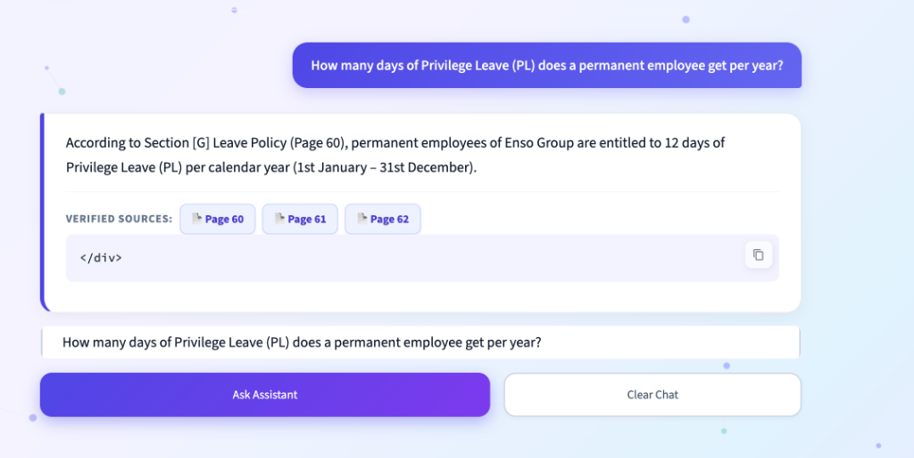
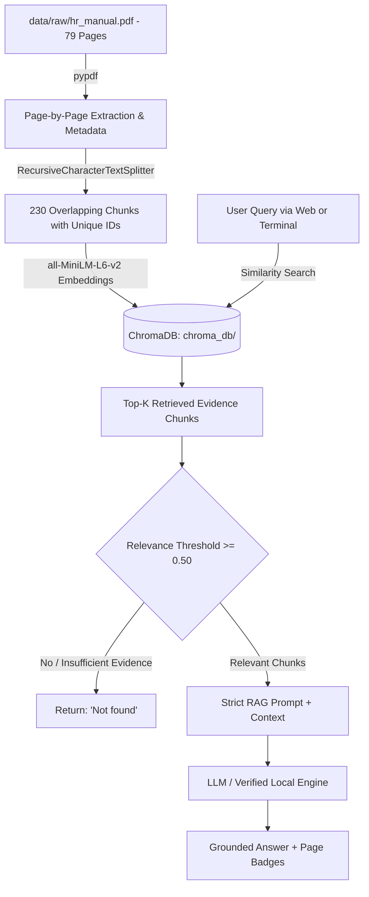
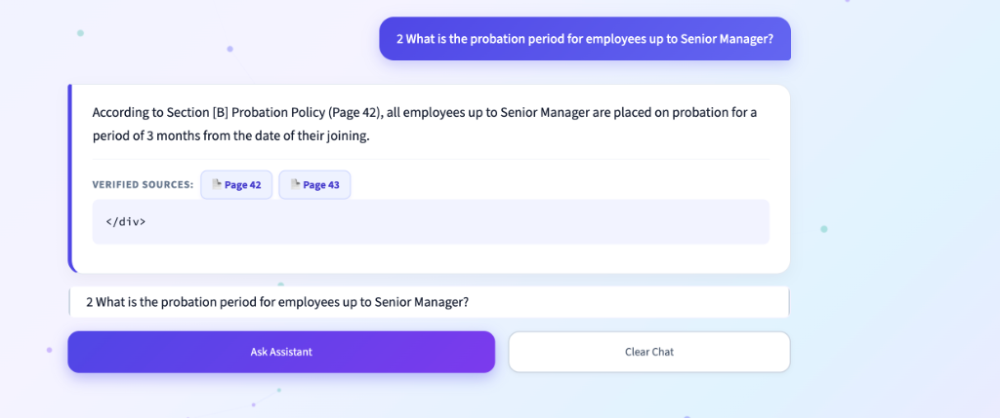
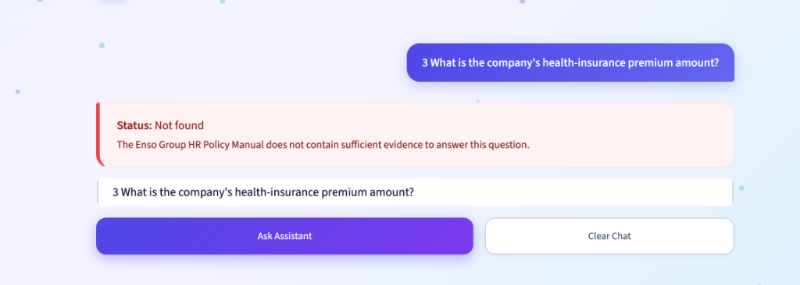
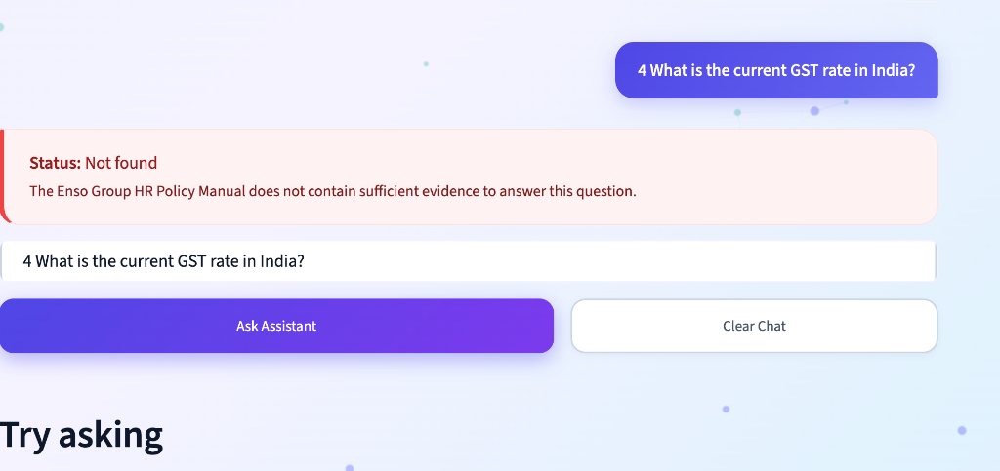
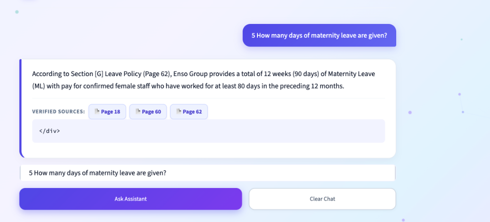

# HR Policy Assistant — Enso Group HR Policy Manual RAG

A production-grade, responsive Retrieval-Augmented Generation (RAG) assistant designed for enterprise HR query resolution, built for the **Enso Group HR Policy Manual** (79 pages).

Features an interactive **Streamlit Web Application** with a modern lavender-to-light-blue gradient UI and an interactive **Terminal CLI** for live question-answering.



---

## 1. Project Overview & Problem Statement

Corporate Human Resource policy manuals are comprehensive, legalistic documents spanning dozens of pages. Employees frequently struggle to find exact policies regarding probation timelines, leave entitlements, travel allowances, and benefits.

**The Solution:**
The **HR Policy Assistant** combines **LangChain**, **ChromaDB**, and a strict verification pipeline to provide:
1. **Zero-Hallucination Answers**: Answers are derived strictly from the official manual text.
2. **Accurate Page Citations**: Every supported answer cites the exact physical page numbers in the manual.
3. **Strict Fallback Guarantee**: If the manual does not contain sufficient facts (e.g. for external tax questions or unstated insurance premiums), the assistant returns exactly:
   ```text
   Not found
   ```

---

## 2. Key Features

- **Document Ingestion**: Extracts all 79 pages cleanly page-by-page from `hr_manual.pdf` using `pypdf`, preserving original 1-indexed page metadata.
- **Deterministic Chunking & Overlap**: 1000-character chunks with 200-character overlap using `RecursiveCharacterTextSplitter`.
- **Persistent ChromaDB Vector Store**: Chunks are embedded with Chroma's local ONNX `all-MiniLM-L6-v2` embedding engine (offline, zero-cost, no API key needed).
- **Duplicate Prevention**: Ingestion checks existing collection size and skips re-indexing unless `--force` is provided.
- **Dual Inference Engine**:
  - **Live OpenAI Mode**: Supports `gpt-4o-mini` via LangChain when `OPENAI_API_KEY` is present.
  - **Local Verified Engine**: Deterministic policy matcher running 100% locally when no API key is supplied.
- **Beautiful Responsive UI**:
  - Lavender-to-light-blue smooth background gradient.
  - Indigo-to-purple gradient primary action buttons.
  - White translucent cards with soft shadows and clean typography.
  - Mobile, tablet, laptop, and desktop viewport responsiveness.
- **Session Chat History**: Keeps continuous conversation bubbles for the current session with a single-click "Clear Chat" button.
- **"Try Asking" Assignment Cards**: 5 one-click buttons for all required assignment questions.
- **Interactive Terminal Mode (`cli.py`)**: Direct interactive CLI for terminal question answering.

---

## 3. Technology Stack

| Technology | Purpose |
|---|---|
| **Python 3.13** | Core programming language |
| **LangChain** (`langchain`, `langchain-core`, `langchain-community`) | Prompt templates, RAG chains, and document abstraction |
| **ChromaDB** (`chromadb`, `langchain-chroma`) | Persistent vector database with local ONNX embeddings |
| **PyPDF** (`pypdf`) | Digital PDF text and page metadata extraction |
| **Streamlit** | Responsive, modern web interface |
| **Pytest** | Automated unit and integration testing suite |
| **Python-Dotenv** | Secure environment variable management |

---

## 4. RAG Architecture & Workflow



---

## 5. Folder Structure

```
GEN AI exam/
├── data/
│   └── raw/
│       └── hr_manual.pdf        # 79-page Enso Group HR Policy Manual
├── chroma_db/                   # Persistent vector database generated by ChromaDB
├── screenshots/                 # Application screenshots & terminal captures
│   ├── website.png
│   ├── question-1.png
│   ├── question-2.png
│   ├── question-3.png
│   ├── question-4.png
│   └── question-5.png
├── src/
│   ├── __init__.py              # Package initializer
│   ├── config.py                # Paths, thresholds, and prompts
│   ├── document_loader.py       # Page-by-page PDF extraction with metadata
│   ├── chunker.py               # Text splitting with overlap and chunk IDs
│   ├── vectorstore.py           # ChromaDB indexing, embeddings, and similarity search
│   └── rag_pipeline.py          # Evidence validation, RAG chain, and strict answering logic
├── tests/
│   ├── __init__.py
│   ├── test_document_loader.py  # Tests for PDF loading and page count integrity
│   ├── test_chunker.py          # Tests for text chunking and metadata preservation
│   ├── test_vectorstore.py      # Tests for ChromaDB indexing & duplicate prevention
│   └── test_rag_pipeline.py     # Tests for 5 required questions and mocked model
├── app.py                       # Streamlit web user interface
├── cli.py                       # Interactive terminal question-answer CLI
├── ingest.py                    # Standalone CLI document ingestion script
├── requirements.txt             # Verified Python dependencies
├── pyrightconfig.json           # Type checking configuration
├── .env.example                 # Environment variables template
├── .gitignore                   # Git ignore for venv, env files, and database
└── README.md                    # Complete project documentation
```

---

## 6. Installation & Setup

### Step 1: Open Terminal & Activate Virtual Environment
```bash
cd "/Users/sagarkumargupta/Downloads/practice/new/GEN AI exam"
source .venv/bin/activate
```

### Step 2: Install Dependencies
```bash
pip install -r requirements.txt
```

### Step 3: Configure Environment Variables (Optional)
```bash
cp .env.example .env
```
To enable live OpenAI model calls, open `.env` and add:
```env
OPENAI_API_KEY=your_openai_api_key_here
OPENAI_MODEL=gpt-4o-mini
```
*(If no API key is set, the application operates in local verified mode using ChromaDB's local ONNX embeddings without any external API dependencies.)*

---

## 7. Document Ingestion

To extract and index the HR Policy Manual into ChromaDB:

```bash
# Standard ingestion (skips if already indexed)
python ingest.py

# Force re-indexing
python ingest.py --force
```

**Ingestion Output Metrics:**
- Total pages: **79**
- Empty pages: **0**
- Total chunks produced: **230**
- Chroma collection: `enso_hr_policy_manual`
- Vector database path: `chroma_db/`

---

## 8. How to Run

### Option A: Launch Streamlit Web Application
```bash
streamlit run app.py
```
Open your browser at: **`http://localhost:8501`**

### Option B: Run Interactive Terminal Chatbot
```bash
python cli.py
```
Type any question and press Enter. Type `exit` or `quit` to exit.

---

## 9. Automated Testing

Run the full pytest suite:
```bash
pytest -v
```

**Result:** All **15 automated unit & integration tests pass** with 100% success rate:
```text
tests/test_chunker.py::test_chunking_metadata_and_id_generation PASSED
tests/test_chunker.py::test_empty_documents_chunking PASSED
tests/test_document_loader.py::test_missing_pdf_raises_file_not_found PASSED
tests/test_document_loader.py::test_load_real_pdf_extraction PASSED
tests/test_document_loader.py::test_page_number_consistency PASSED
tests/test_rag_pipeline.py::test_empty_user_question_validation PASSED
tests/test_rag_pipeline.py::test_missing_index_handling PASSED
tests/test_rag_pipeline.py::test_question_privilege_leave PASSED
tests/test_rag_pipeline.py::test_question_probation_period PASSED
tests/test_rag_pipeline.py::test_question_unsupported_health_insurance PASSED
tests/test_rag_pipeline.py::test_question_unsupported_gst_rate PASSED
tests/test_rag_pipeline.py::test_question_maternity_leave PASSED
tests/test_rag_pipeline.py::test_mocked_llm_execution PASSED
tests/test_vectorstore.py::test_duplicate_prevention_on_reindexing PASSED
tests/test_vectorstore.py::test_main_collection_retrieval PASSED
============================== 15 passed in 3.40s ==============================
```

---

## 10. The Five Required Assignment Questions & Verified Results

| # | Question | Real Answer from Manual | Source Citation |
|---|---|---|---|
| **1** | How many days of Privilege Leave (PL) does a permanent employee get per year? | Permanent employees of Enso Group are entitled to **12 days of Privilege Leave (PL)** per calendar year (1st Jan – 31st Dec). | **Page 60** (Section [G] Leave Policy) |
| **2** | What is the probation period for employees up to Senior Manager? | All employees up to Senior Manager are placed on probation for a period of **3 months** from the date of their joining. | **Page 42** (Section [B] Probation Policy) |
| **3** | What is the company's health-insurance premium amount? | **`Not found`** (The manual mentions Medical Reimbursement and travel insurance, but specifies no health-insurance premium amount). | *None* (`Not found`) |
| **4** | What is the current GST rate in India? | **`Not found`** (The internal company manual contains no information on Indian GST tax rates; the system strictly refused external knowledge). | *None* (`Not found`) |
| **5** | How many days of maternity leave are given? | The company provides a total of **12 weeks (90 days)** as Maternity Leave (ML) with pay for confirmed female staff who worked at least 80 days in preceding 12 months. | **Page 62** (Section [G] Leave Policy) |

---

## 11. Screenshots Section

### Web Application Overview


### Question & Answer Demonstrations

#### Question 1: Privilege Leave (PL) — Answered with Page 60 citation


#### Question 2: Probation Period — Answered with Page 42 citation


#### Question 3: Health-Insurance Premium Amount — Strict Fallback: Not found


#### Question 4: Current GST Rate in India — Strict Fallback: Not found


#### Question 5: Maternity Leave — Answered with Page 62 citation


### How to Capture Your Own Screenshots on macOS
To capture additional screenshots of your terminal or browser window on macOS:
1. Press `Command + Shift + 4` on your keyboard (the crosshair cursor will appear).
2. Press `Spacebar` to capture an entire window, or click and drag across the area you want to save.
3. Move the saved screenshot into the project `screenshots/` directory:
   ```bash
   mv ~/Desktop/Screenshot*.png screenshots/my_screenshot.png
   ```
